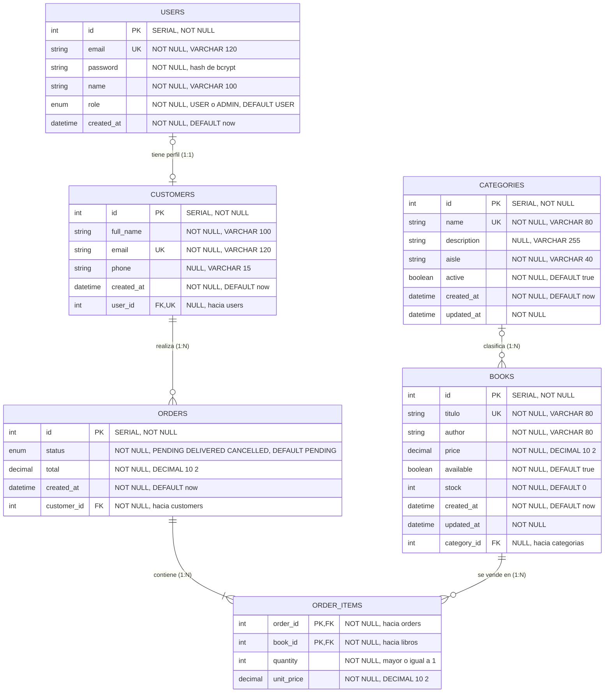

# Modelo ER del emprendimiento · Grupo G03
 
**Emprendimiento:** Librería Sapientia Logos · **Desarrollo Web Avanzado (A0R04) · ESPE**
 
> Actividad 3 de la sesión 4. Es la base del `schema.prisma` del Lab 2 y de las relaciones del Lab 3.
 
## Diagrama

## Entidades

| Entidad | Tabla en PostgreSQL | Modelo Prisma | Clave primaria | Valores únicos |
|---|---|---|---|---|
| USERS | `users` | `User` | `id` | `email` |
| CUSTOMERS | `customers` | `Customer` | `id` | `email`, `user_id` |
| CATEGORIES | `categorias` | `Category` | `id` | `name` |
| BOOKS | `libros` | `Book` | `id` | `titulo` |
| ORDERS | `orders` | `Order` | `id` | ninguno |
| ORDER_ITEMS | `order_items` | `OrderItem` | `order_id` + `book_id` (compuesta) | ninguno |

### USERS (`users`): cuenta de acceso

| Atributo (columna) | Tipo | Restricciones | Campo en Prisma |
|---|---|---|---|
| `id` | INTEGER (SERIAL) | PK, NOT NULL | `id` |
| `email` | VARCHAR(120) | NOT NULL, único | `email` |
| `password` | TEXT | NOT NULL; guarda el hash de bcrypt, nunca la clave | `password` |
| `name` | VARCHAR(100) | NOT NULL | `name` |
| `role` | enum `Role` | NOT NULL, DEFAULT `USER` | `role` |
| `created_at` | TIMESTAMP(3) | NOT NULL, DEFAULT `now()` | `createdAt` |

### CUSTOMERS (`customers`): perfil del cliente

| Atributo (columna) | Tipo | Restricciones | Campo en Prisma |
|---|---|---|---|
| `id` | INTEGER (SERIAL) | PK, NOT NULL | `id` |
| `full_name` | VARCHAR(100) | NOT NULL | `fullName` |
| `email` | VARCHAR(120) | NOT NULL, único | `email` |
| `phone` | VARCHAR(15) | NULL (opcional) | `phone` |
| `created_at` | TIMESTAMP(3) | NOT NULL, DEFAULT `now()` | `createdAt` |
| `user_id` | INTEGER | FK hacia `users.id`, único, NULL | `userId` |

### CATEGORIES (`categorias`)

| Atributo (columna) | Tipo | Restricciones | Campo en Prisma |
|---|---|---|---|
| `id` | INTEGER (SERIAL) | PK, NOT NULL | `id` |
| `name` | VARCHAR(80) | NOT NULL, único | `name` |
| `description` | VARCHAR(255) | NULL (opcional) | `description` |
| `aisle` | VARCHAR(40) | NOT NULL (pasillo donde se ubica la categoría) | `aisle` |
| `active` | BOOLEAN | NOT NULL, DEFAULT `true` | `active` |
| `created_at` | TIMESTAMP(3) | NOT NULL, DEFAULT `now()` | `createdAt` |
| `updated_at` | TIMESTAMP(3) | NOT NULL, lo actualiza Prisma con `@updatedAt` | `updatedAt` |

### BOOKS (`libros`): entidad principal

| Atributo (columna) | Tipo | Restricciones | Campo en Prisma |
|---|---|---|---|
| `id` | INTEGER (SERIAL) | PK, NOT NULL | `id` |
| `titulo` | VARCHAR(80) | NOT NULL, único | `title` |
| `author` | VARCHAR(80) | NOT NULL | `author` |
| `price` | DECIMAL(10,2) | NOT NULL; el servicio exige un valor mayor a 0 | `price` |
| `available` | BOOLEAN | NOT NULL, DEFAULT `true` | `available` |
| `stock` | INTEGER | NOT NULL, DEFAULT `0`; es el recurso limitado de los pedidos | `stock` |
| `created_at` | TIMESTAMP(3) | NOT NULL, DEFAULT `now()` | `createdAt` |
| `updated_at` | TIMESTAMP(3) | NOT NULL, lo actualiza Prisma con `@updatedAt` | `updatedAt` |
| `category_id` | INTEGER | FK hacia `categorias.id`, NULL | `categoryId` |

### ORDERS (`orders`)

| Atributo (columna) | Tipo | Restricciones | Campo en Prisma |
|---|---|---|---|
| `id` | INTEGER (SERIAL) | PK, NOT NULL | `id` |
| `status` | enum `OrderStatus` | NOT NULL, DEFAULT `PENDING` | `status` |
| `total` | DECIMAL(10,2) | NOT NULL | `total` |
| `created_at` | TIMESTAMP(3) | NOT NULL, DEFAULT `now()` | `createdAt` |
| `customer_id` | INTEGER | FK hacia `customers.id`, NOT NULL | `customerId` |

### ORDER_ITEMS (`order_items`): tabla intermedia de la relación N:M

| Atributo (columna) | Tipo | Restricciones | Campo en Prisma |
|---|---|---|---|
| `order_id` | INTEGER | PK compuesta, FK hacia `orders.id` | `orderId` |
| `book_id` | INTEGER | PK compuesta, FK hacia `libros.id` | `bookId` |
| `quantity` | INTEGER | NOT NULL; el servicio exige un entero mayor o igual a 1 | `quantity` |
| `unit_price` | DECIMAL(10,2) | NOT NULL; guarda el precio vigente al momento de la compra | `unitPrice` |

## Relaciones, cardinalidad y `onDelete`

| Entidad A | Cardinalidad | Entidad B | `onDelete` | Por qué se eligió |
|---|---|---|---|---|
| USERS | 1:1 | CUSTOMERS | `Cascade` | El perfil de cliente no tiene sentido sin su cuenta: al borrar el usuario se borra su perfil. La FK `user_id` es única para garantizar el 1:1. |
| CATEGORIES | 1:N | BOOKS | `SetNull` | Eliminar una categoría no debe eliminar los libros del catálogo: quedan sin categoría y se pueden reclasificar. |
| CUSTOMERS | 1:N | ORDERS | `Restrict` | No se puede borrar un cliente que tiene pedidos: se conserva el historial de ventas. |
| ORDERS | 1:N | ORDER_ITEMS | `Cascade` | Un ítem no existe sin su pedido: al borrar el pedido se borran sus líneas. |
| BOOKS | 1:N | ORDER_ITEMS | `Restrict` | No se puede borrar un libro que ya se vendió: se protege el historial. Si se intenta, la API responde 409. |
| BOOKS | N:M | ORDERS | n/a | Un libro está en muchos pedidos y un pedido incluye muchos libros. Se resuelve con ORDER_ITEMS, que guarda `quantity` y `unit_price`. |

## Mapeo y rendimiento

- **Enums:** `Role` (`USER`, `ADMIN`) y `OrderStatus` (`PENDING`, `DELIVERED`, `CANCELLED`).
- **Tipos:** `price`, `total` y `unit_price` son `DECIMAL(10,2)` para no perder centavos. Las fechas son `TIMESTAMP(3)`.
- **Índices:** `libros(category_id)`, `orders(customer_id)` y el índice compuesto `orders(status, created_at)`, que acelera el filtro del listado de administración. `order_items` usa la clave primaria compuesta `(order_id, book_id)`: un libro aparece una sola vez por pedido.
- **Nombres:** las tablas y columnas están en snake_case con `@map` y `@@map`. Las tablas heredadas del Lab 2 conservan sus nombres (`libros`, `categorias`).

## Cambios respecto al Lab 2

- `SALES` y `SALE_ITEMS` se reemplazan por `ORDERS` y `ORDER_ITEMS`: ahora el pedido pertenece a un cliente y descuenta stock.
- `BOOKS.price` pasa de `Float` a `Decimal(10,2)` y `BOOKS.stock` pasa de opcional a obligatorio con valor por defecto 0.
- `BOOKS` recibe la columna `category_id`, que activa la relación 1:N con `CATEGORIES`.
- Se agregan `USERS` y `CUSTOMERS` para la autenticación y el perfil 1:1.