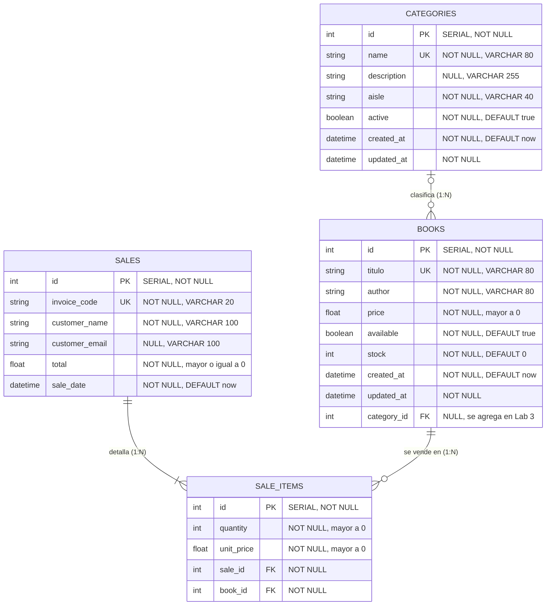

# Modelo ER del emprendimiento · Grupo G03
 
**Emprendimiento:** Librería Sapientia Logos · **Desarrollo Web Avanzado (A0R04) · ESPE**
 
> Actividad 3 de la sesión 4. Es la base del `schema.prisma` del Lab 2 y de las relaciones del Lab 3.
 
## Diagrama
 

 
## Entidades
 
Cada entidad se guarda en una tabla de PostgreSQL. La columna «Campo en Prisma» muestra el nombre que se usa en `prisma/schema.prisma` cuando difiere del de la columna.
 
| Entidad | Tabla en PostgreSQL | Modelo Prisma | Clave primaria | Valores únicos |
|---|---|---|---|---|
| BOOKS | `libros` | `Book` | `id` | `titulo` |
| CATEGORIES | `categorias` | `Category` | `id` | `name` |
| SALES | `sales` | `Sale` | `id` | `invoice_code` |
| SALE_ITEMS | `sale_items` | `SaleItem` | `id` | ninguno |
 
### BOOKS (`libros`): entidad principal
 
| Atributo (columna) | Tipo | Restricciones | Campo en Prisma |
|---|---|---|---|
| `id` | INTEGER (SERIAL) | PK, NOT NULL | `id` |
| `titulo` | VARCHAR(80) | NOT NULL, único | `title` |
| `author` | VARCHAR(80) | NOT NULL | `author` |
| `price` | DOUBLE PRECISION | NOT NULL; el servicio exige un valor mayor a 0 | `price` |
| `available` | BOOLEAN | NOT NULL, DEFAULT `true` | `available` |
| `stock` | INTEGER | NOT NULL, DEFAULT `0`; el servicio exige un entero mayor o igual a 0 | `stock` |
| `created_at` | TIMESTAMP(3) | NOT NULL, DEFAULT `now()` | `createdAt` |
| `updated_at` | TIMESTAMP(3) | NOT NULL, lo actualiza Prisma con `@updatedAt` | `updatedAt` |
| `category_id` | INTEGER | FK hacia `categorias.id`, NULL. Se agrega en el Lab 3 | n/a |
 
### CATEGORIES (`categorias`): segunda entidad
 
| Atributo (columna) | Tipo | Restricciones | Campo en Prisma |
|---|---|---|---|
| `id` | INTEGER (SERIAL) | PK, NOT NULL | `id` |
| `name` | VARCHAR(80) | NOT NULL, único | `name` |
| `description` | VARCHAR(255) | NULL (campo opcional) | `description` |
| `aisle` | VARCHAR(40) | NOT NULL (pasillo donde se ubica la categoría) | `aisle` |
| `active` | BOOLEAN | NOT NULL, DEFAULT `true` | `active` |
| `created_at` | TIMESTAMP(3) | NOT NULL, DEFAULT `now()` | `createdAt` |
| `updated_at` | TIMESTAMP(3) | NOT NULL, lo actualiza Prisma con `@updatedAt` | `updatedAt` |
 
### SALES (`sales`)
 
| Atributo (columna) | Tipo | Restricciones | Campo en Prisma |
|---|---|---|---|
| `id` | INTEGER (SERIAL) | PK, NOT NULL | `id` |
| `invoice_code` | VARCHAR(20) | NOT NULL, único | `invoiceCode` |
| `customer_name` | VARCHAR(100) | NOT NULL | `customerName` |
| `customer_email` | VARCHAR(100) | NULL (campo opcional) | `customerEmail` |
| `total` | DOUBLE PRECISION | NOT NULL; regla del modelo: mayor o igual a 0 | `total` |
| `sale_date` | TIMESTAMP(3) | NOT NULL, DEFAULT `now()` | `saleDate` |
 
### SALE_ITEMS (`sale_items`)
 
| Atributo (columna) | Tipo | Restricciones | Campo en Prisma |
|---|---|---|---|
| `id` | INTEGER (SERIAL) | PK, NOT NULL | `id` |
| `quantity` | INTEGER | NOT NULL; regla del modelo: mayor a 0 | `quantity` |
| `unit_price` | DOUBLE PRECISION | NOT NULL; regla del modelo: mayor a 0 | `unitPrice` |
| `sale_id` | INTEGER | FK hacia `sales.id`, NOT NULL | `saleId` |
| `book_id` | INTEGER | FK hacia `libros.id`, NOT NULL | `bookId` |
 
Las reglas «mayor a 0» de `quantity`, `unit_price` y «mayor o igual a 0» de `total` son reglas del modelo. Todavía no tienen validación en el código porque la API de ventas se desarrolla después del Lab 2. Las de `price` y `stock` de BOOKS sí se validan en `book.service.js`.
 
## Relaciones
 
| Entidad A | Cardinalidad | Entidad B | Ejemplo en una frase |
|---|---|---|---|
| CATEGORIES | 1:N | BOOKS | Una categoría agrupa muchos libros; un libro pertenece a una sola categoría y puede no tener ninguna (`category_id` es opcional). |
| SALES | 1:N | SALE_ITEMS | Una venta tiene uno o más ítems; cada ítem pertenece a una sola venta. |
| BOOKS | 1:N | SALE_ITEMS | Un libro puede aparecer en muchos ítems de venta; cada ítem corresponde a un solo libro. |
| BOOKS | N:M | SALES | Un libro se vende en muchas ventas y una venta incluye muchos libros. Se resuelve con la tabla intermedia SALE_ITEMS, que además guarda `quantity` y `unit_price`. |
 
No hay relaciones 1:1 en este modelo.

## ¿Qué se implementa en cada laboratorio?

- **Lab 2:** la entidad principal y una segunda entidad en `schema.prisma`, sin relaciones.
- **Lab 3:** las relaciones y las entidades restantes.
