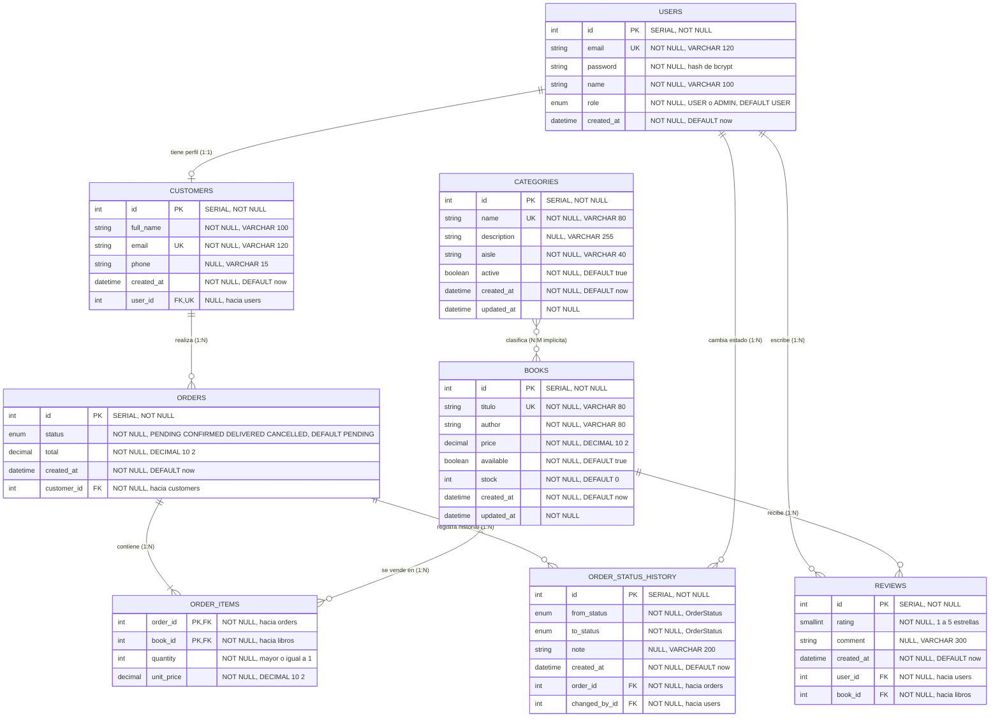

# Modelo ER del emprendimiento · Grupo G03 (Lab 3 + Taller)

**Emprendimiento:** Librería Sapientia Logos · **Desarrollo Web Avanzado (A0R04) · ESPE**

## Diagrama ER

## Entidades y Tablas

| Entidad | Tabla en PostgreSQL | Modelo Prisma | Clave primaria | Valores únicos |
|---|---|---|---|---|
| USERS | `users` | `User` | `id` | `email` |
| CUSTOMERS | `customers` | `Customer` | `id` | `email`, `user_id` |
| CATEGORIES | `categorias` | `Category` | `id` | `name` |
| BOOKS | `libros` | `Book` | `id` | `titulo` |
| ORDERS | `orders` | `Order` | `id` | ninguno |
| ORDER_ITEMS | `order_items` | `OrderItem` | `order_id` + `book_id` (compuesta) | ninguno |
| REVIEWS (Taller A) | `reviews` | `Review` | `id` | `user_id` + `book_id` (compuesta) |
| ORDER_STATUS_HISTORY (Taller C) | `order_status_history` | `OrderStatusHistory` | `id` | ninguno |

### Relaciones y Reglas Referenciales

1. **`User` - `Customer` (1:1):**
   - Lado con FK: `Customer` (`user_id` único).
   - `onDelete: Cascade` (si se elimina el usuario, se elimina su perfil de cliente).

2. **`Category` - `Book` (N:M implícita - Taller B):**
   - Prisma administra la tabla de unión `_BookToCategory`.
   - Permite que un libro tenga múltiples categorías y una categoría clasifique múltiples libros.

3. **`Customer` - `Order` (1:N):**
   - Lado con FK: `Order` (`customer_id`).
   - `onDelete: Restrict` (no se puede eliminar un cliente con pedidos históricos).

4. **`Order` - `OrderItem` - `Book` (N:M explícita):**
   - Tabla intermedia `order_items` con atributos propios (`quantity`, `unit_price`).
   - PK compuesta `[orderId, bookId]`.
   - `Order` a `OrderItem`: `onDelete: Cascade`.
   - `Book` a `OrderItem`: `onDelete: Restrict` (no se borra un libro que ya tiene ventas registradas).

5. **`User` - `Review` y `Book` - `Review` (1:N - Taller A):**
   - `@@unique([userId, bookId])`: un usuario solo puede reseñar un libro una única vez.
   - `@@index([bookId])`: acelera las consultas de listado y cálculo de promedio (`_avg`).
   - `onDelete: Cascade` en ambos extremos.

6. **`Order` - `OrderStatusHistory` y `User` - `OrderStatusHistory` (1:N - Taller C):**
   - Registra cada transición de estado en la máquina de estados.
   - `Order` a `OrderStatusHistory`: `onDelete: Cascade`.
   - `User` a `OrderStatusHistory`: `onDelete: Restrict` (preserva la autoría del cambio).
