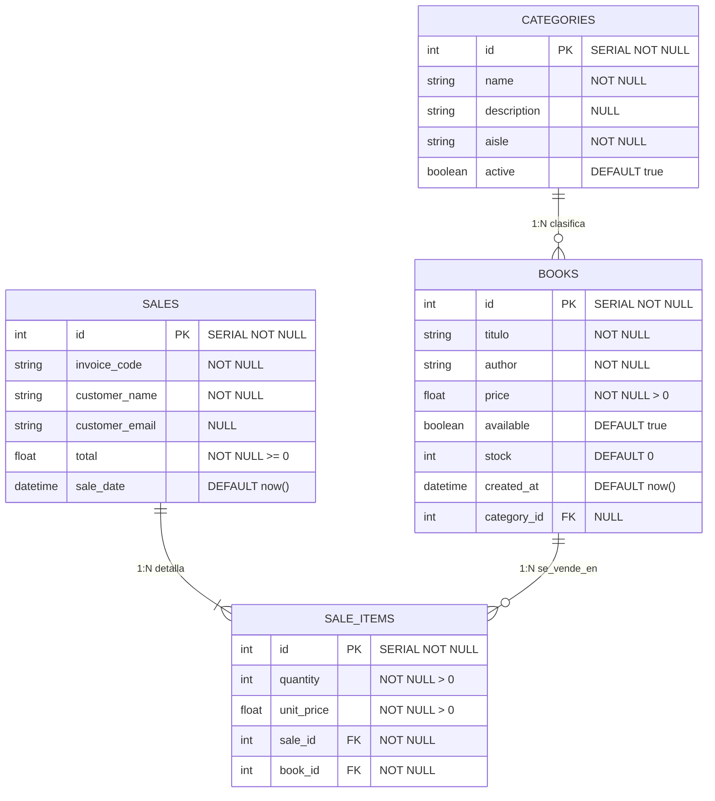

# Modelo ER del emprendimiento · Grupo GXX

> Actividad 3 de la sesión 4. Es la base del `schema.prisma` del Lab 2 y de las relaciones del Lab 3.

## Diagrama

Edítalo en https://mermaid.live (GitHub lo muestra como diagrama). Reemplaza el ejemplo por tus entidades.

## Entidades

| Entidad | Atributos (tipo) | Clave primaria | Únicos / obligatorios / reglas |
|---|---|---|---|
| BOOKS| id (PK), titulo, author, price, available, creado_en, category_id FK |PK| UK| |
| CATEGORIES| id (PK), name, description, aisle, active |PK| UK| |
| SALES| id (PK), invoice_code, customer_name, customer_email, total, sale_date |PK| UK| |
| SALE_ITEMS| id (PK), quantity, unit_price, sale_id FK, book_id FK |PK| UK| |

## Relaciones

| Entidad A | Cardinalidad (1:1, 1:N, N:M) | Entidad B | Ejemplo en una frase |
|---|---|---|---|
| CATEGORIES | 1:N | BOOKS | una categoría puede tener muchos libros |
| BOOKS | 1:N | SALE_ITEMS | un libro puede estar en muchos items de venta |
| SALES | 1:N | SALE_ITEMS | una venta puede tener muchos items |

## ¿Qué se implementa en cada laboratorio?

- **Lab 2:** la entidad principal y una segunda entidad en `schema.prisma`, sin relaciones.
- **Lab 3:** las relaciones y las entidades restantes.
