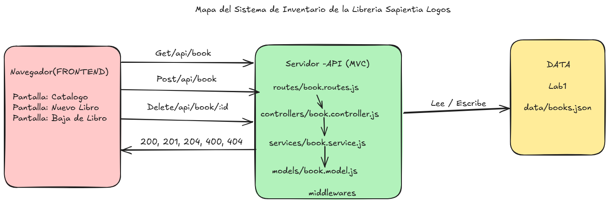

# Propuesta del emprendimiento · Grupo G03

> Actividad 1 de la sesión 1. Complétala antes del Paso 1 del laboratorio.

| Campo | Respuesta |
|---|---|
| Nombre del emprendimiento | Libreria Sapientia Logos|
| Problema que resuelve | Muchas librerias pequeñas como Sapientia Logos venden libros, pero suelen llevar el inventario de sus transacciones en cuadernos, por lo que existe cierta desorganizacion administrativa, ya que no hay un stock que se mantenga actualizado. realmente para cada articulo de la misma forma los clientes no tienen una forma real de saber que libros estan disponibles y su prescio sin necesidad de ir a un local, este sistema centraliza el catalogo y las ventas  para tener el inventario siempre actualizado y disponible para cualquier cliente
| Usuarios (quién lo usa) |"Dueño o vendedor: realiza las ventas ademas de registrar y actualizatr producots en stock" .  "Cliente: Consulta catalgo, precios y disponibilidad, incluso podriaa comparar el libro en digital"|
| 3 funciones principales | 1. Gestionar Catalogo(registrar,consultar,edira o eliminar libros) 2. Controlar el stock(descontar lo que se vende y detectar q se agota)  3. Registro de Ventas |

## Mapa frontend–backend

El diagrama se realizo mediante la herramienta de excalidraw

// Adjuntamos link del excalidraw: https://excalidraw.com/#room=158b7afad7e33f50a8e3,3aJD3mHC4zw-dI3R1W-qUg

## Entidades (3) y atributos principales

| Entidad | Atributos | ¿Se relaciona con…? |
|---|---|---|
| Book (Libro - Lab 1) | `id`, `author`, `title`, `price`, `available` | Se relaciona con Category y Sale |
| Customer (Cliente - Lab 2) | `id`, `name`, `email`, `phone` | Se relaciona con Sale (compras realizadas) |
| Sale (Venta - Lab 3) | `id`, `bookId`, `customerId`, `quantity`, `total`, `date` | Se relaciona con Book y Customer |

> La primera entidad es la que implementan en este laboratorio (4 o más campos). Las otras dos se usan en los Labs 2 y 3.

## 3 endpoints iniciales

| Verbo | Ruta | Código de estado |
|---|---|---|
| GET | `/api/books` | 200 OK |
| POST | `/api/books` | 201 Created (400 si datos inválidos) |
| GET | `/api/books/:id` | 200 OK (404 si no existe) |
