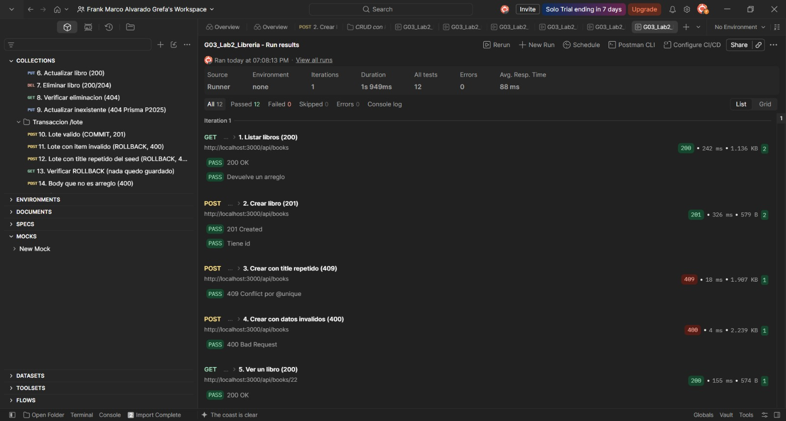
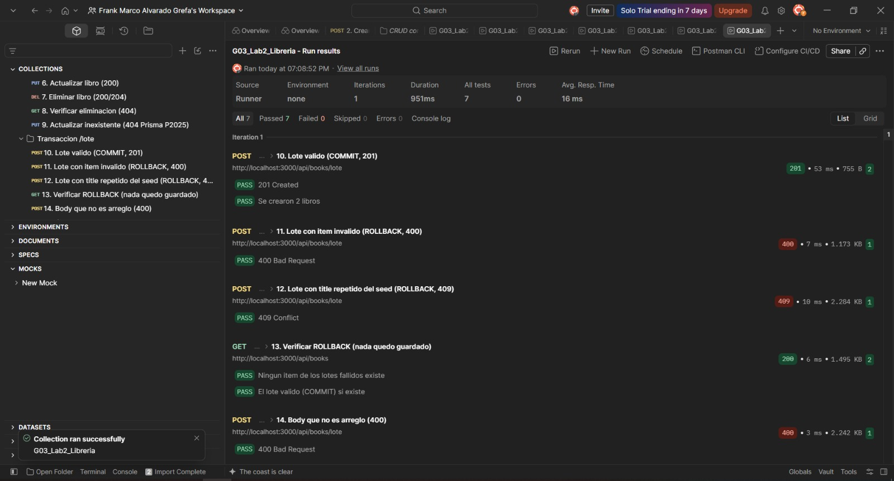
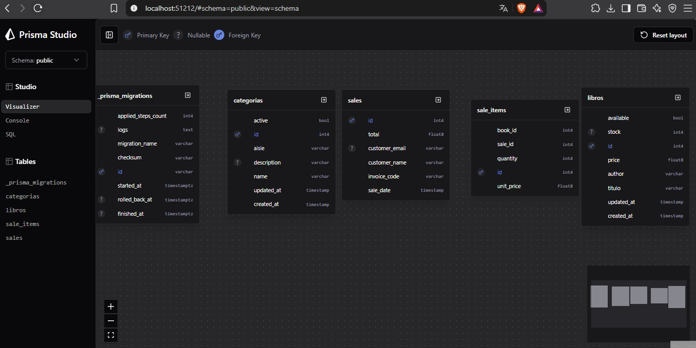
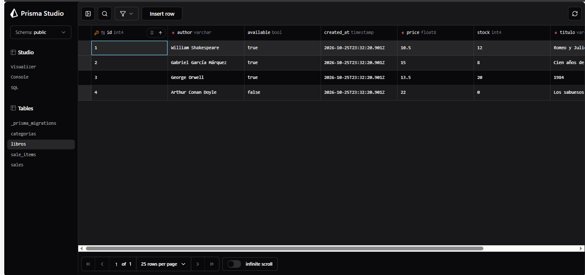

# Laboratorio 2 · Percistencia con prisma

**Desarrollo Web Avanzado (A0R04) · ESPE · Unidad 1: Persistencia de datos y ORM**

| Dato | Valor |
|---|---|
| Grupo | G03 |
| Emprendimiento | Librería Sapientia Logos |
| Integrantes | 1. Jose Reinoso 2. Yostin Sisalema 3. Frank Alvarado |
| NRC | 36878 |
| Fecha | 18-10-2026 |
| Repositorio | https://github.com/joseanxs/G03_Lab1_Libreria.git (rama lab2-prisma)|

## Descripción
 
La API de la librería del Lab 1 dejó de guardar sus datos en `data/books.json` y ahora los guarda en PostgreSQL a través de Prisma ORM 7.10.1 con el adaptador `@prisma/adapter-pg`. Solo cambió la capa de datos: el servicio usa Prisma y el modelo pasó de `src/models/` a `prisma/schema.prisma`. El controlador y las rutas son los del Lab 1, con una única adición, el endpoint `POST /api/books/lote`, que crea varios libros dentro de una transacción.

## Requisitos
 
- Node.js 20.19 o superior
- PostgreSQL 17 (con Docker o en Neon)
- Postman
- Git

## Cómo ejecutar la base y ejecutar

### 1. API REST en Express (src/  -> carpeta principal del proyecto)

```bash
npm install
cp .env.example .env      # en Windows: copy .env.example .env
npm run dev               # http://localhost:3000 o puerto asignado
```

Importa en Postman `postman/G03_Lab2.postman_collection.json` y ejecuta **Run collection**.

### 2. client/ (Usando React con Vite)

```bash
cd client
npm install
npm run dev
```
Credenciales de prueba (precargadas): admin@espe.edu.ec / admin

### 3. Crear la base de datos
**Opción A: PostgreSQL 17 con Docker**
 
```bash
docker compose up -d
```
 
Crea un contenedor `lab2-postgres` con usuario `espe_user`, clave `espe_password`, base `espe_db` y puerto `5432`. Para detenerlo: `docker compose down`.

### 4. Migrar, generar el cliente y cargar datos
 
```bash
npm run db:migrate     # aplica las migraciones de prisma/migrations
npm run db:generate    # Prisma 7 genera el cliente por separado
npm run db:seed        # carga los datos de prueba
npm run dev            # API en http://localhost:3000
```
 
| Script | Comando de Prisma | Qué hace |
|---|---|---|
| `npm run db:migrate` | `prisma migrate dev` | Crea las tablas a partir del schema y registra la migración |
| `npm run db:generate` | `prisma generate` | Genera el cliente de Prisma. Se ejecuta después de cada migración |
| `npm run db:seed` | `prisma db seed` | Borra los datos y carga 4 libros y 3 categorías |
| `npm run db:studio` | `prisma studio` | Abre Prisma Studio en el navegador para ver las tablas |


## Estructura del proyecto
 
```
prisma/
├─ schema.prisma         ← modelo de datos (reemplaza a src/models/)
├─ migrations/           ← migraciones versionadas en Git (init + migration_lock.toml)
└─ seed.js               ← datos de prueba, se puede repetir
prisma.config.ts         ← URL de la base y comando del seed (Prisma 7)
docker-compose.yml       ← PostgreSQL 17 opcional
.env.example             ← plantilla de variables, sin claves reales
src/
├─ app.js                ← express.json, logger, CORS, prefijo /api y manejo de errores
├─ server.js             ← conecta Prisma y levanta el servidor
├─ db/prisma.js          ← única instancia de PrismaClient (adaptador PrismaPg)
├─ routes/
│  ├─ index.js           ← monta /api/books
│  └─ book.routes.js     ← verbo + URL → acción del controlador
├─ controllers/
│  └─ book.controller.js ← lee req, llama al servicio, decide código + JSON
├─ services/
│  └─ book.service.js    ← validaciones y todas las consultas a Prisma
├─ middlewares/          ← logger, notFound, errorHandler
└─ utils/httpError.js
postman/G03_Lab2.postman_collection.json
evidencias/              ← capturas de Postman y Prisma Studio
MODELO_ER.md             ← diagrama ER del emprendimiento
client/                  ← interfaz en React del Lab 1 (no se modificó en este laboratorio)
```
 
Flujo de una petición: **ruta → controlador → servicio → Prisma → PostgreSQL** y de vuelta. Las consultas de Prisma están solo en `src/services/`. Las carpetas `data/` y `src/models/` ya no existen. El proyecto usa CommonJS (`require` / `module.exports`).
 
## Modelo de datos
 
El diagrama completo con cardinalidades está en [MODELO_ER.md](MODELO_ER.md). En este laboratorio se declaran las cuatro entidades en `schema.prisma`, todavía sin `@relation`. Las relaciones se programan en el Lab 3.
 
| Modelo Prisma | Tabla | Campos principales | Restricciones |
|---|---|---|---|
| `Book` | `libros` | `id`, `title` (columna `titulo`), `author`, `price`, `available`, `stock`, `createdAt`, `updatedAt` | `title` único, `VarChar(80)`; `available` por defecto `true`; `stock` por defecto `0` |
| `Category` | `categorias` | `id`, `name`, `description`, `aisle`, `active`, `createdAt`, `updatedAt` | `name` único; `description` opcional (`?`), `VarChar(255)` |
| `Sale` | `sales` | `id`, `invoiceCode`, `customerName`, `customerEmail`, `total`, `saleDate` | `invoiceCode` único; `customerEmail` opcional; `saleDate` por defecto `now()` |
| `SaleItem` | `sale_items` | `id`, `quantity`, `unitPrice`, `saleId`, `bookId` | `saleId` y `bookId` son columnas sin relación hasta el Lab 3 |
 
Atributos de Prisma usados: `@id @default(autoincrement())`, `@unique`, `@default`, `@db.VarChar(n)`, campos opcionales con `?`, `@map` y `@@map`, y `@updatedAt`.
 
## Endpoints de la entidad
 
Ruta base: `/api/books`.
 
| Verbo | Ruta | Acción | Éxito | Errores |
|---|---|---|---|---|
| GET | `/api/books` | Listar todos los libros | 200 | n/a |
| GET | `/api/books/:id` | Ver un libro por su ID | 200 | 400, 404 |
| POST | `/api/books` | Crear un libro con datos validados | 201 | 400, 409 |
| PUT | `/api/books/:id` | Actualizar campos de un libro existente | 200 | 400, 404, 409 |
| DELETE | `/api/books/:id` | Eliminar un libro por su ID | 204 | 400, 404 |
| POST | `/api/books/lote` | Crear varios libros en una transacción | 201 | 400, 409 |
| DELETE | `/api/books` | Eliminar todos los libros (solo para pruebas) | 204 | n/a |
 
### Manejo de errores
 
`errorHandler.js` traduce los errores de Prisma a códigos HTTP y responde siempre con el mismo formato:
 
```json
{ "status": "error", "statusCode": 409, "message": "Ya existe un registro con ese valor único" }
```
 
| Origen | Código HTTP | Cuándo ocurre |
|---|---|---|
| Prisma `P2002` | 409 | Valor único repetido (por ejemplo, un `title` que ya existe) |
| Prisma `P2025` | 404 | El registro que se quiere actualizar o borrar no existe |
| Prisma `P2000` | 400 | Un valor excede la longitud permitida de la columna |
| `HttpError` | el que indique | Validaciones del servicio (400) y libro inexistente (404) |
| Cualquier otro | 500 | Error inesperado; el mensaje interno no se muestra al cliente |
 
## Validaciones del servicio
 
Las validaciones están en `validate()` dentro de `src/services/book.service.js`. En `PUT` solo se validan los campos que se envían.
 
1. **Título (`title`)**: obligatorio al crear, texto de al menos 2 caracteres y máximo 80. Debe ser único; si se repite responde 409.
2. **Precio (`price`)**: obligatorio al crear, número finito mayor a 0.
3. **Autor (`author`)**: obligatorio al crear, texto de al menos 2 caracteres y máximo 80.
4. **Stock (`stock`)**: si se envía, entero mayor o igual a 0. Si no se envía, vale 0.
5. **Disponibilidad (`available`)**: si se envía, booleano (`true` o `false`). Por defecto es `true`.
6. **Identificador (`:id`)**: debe ser numérico; si no, responde 400.
Cualquier incumplimiento lanza `HttpError(400, mensaje)`.
 
## Transacción: `POST /api/books/lote`
 
El endpoint recibe un arreglo de libros y los guarda con `prisma.$transaction(async (tx) => ...)`. Dentro de la transacción, el servicio valida cada ítem y lo crea con `tx.book.create`, no con `prisma`. Si todos pasan, Prisma confirma la transacción (**COMMIT**) y responde 201 con los libros creados. Si un ítem falla por una validación (400) o por un valor único repetido (409), el error cancela la transacción (**ROLLBACK**) y no queda ningún libro del lote en la base.
 
**COMMIT (201)**
 
```json
[
  { "title": "El Principito", "author": "Antoine de Saint-Exupéry", "price": 9.5, "stock": 10 },
  { "title": "Rayuela", "author": "Julio Cortázar", "price": 14, "stock": 6 }
]
```
 
**ROLLBACK por ítem inválido (400).** El segundo libro tiene precio negativo, por lo que tampoco se guarda el primero:
 
```json
[
  { "title": "Libro que se deshace", "author": "Autor Uno", "price": 10 },
  { "title": "Libro inválido", "author": "Autor Dos", "price": -5 }
]
```
 
Respuesta: `"message": "Ítem 2: El precio debe ser un número mayor a 0"`.
 
**ROLLBACK por título repetido (409).** El segundo título ya existe en el seed (`Romeo y Julieta`), así que el primero tampoco se guarda:
 
```json
[
  { "title": "Otro libro que se deshace", "author": "Autor Uno", "price": 10 },
  { "title": "Romeo y Julieta", "author": "William Shakespeare", "price": 10.5 }
]
```
 
Si el cuerpo no es un arreglo o llega vacío, el controlador responde 400 con el mensaje `El body debe ser un arreglo con al menos un libro`.
 
## Pruebas en Postman
 
Importa `postman/G03_Lab2.postman_collection.json`, deja la URL base en `http://localhost:3000`, ejecuta antes `npm run db:seed` y usa **Run collection**. La colección tiene 14 peticiones:
 
| # | Petición | Resultado esperado |
|---|---|---|
| 1 | Listar libros | 200 |
| 2 | Crear libro | 201 |
| 3 | Crear con title repetido | 409 |
| 4 | Crear con datos inválidos | 400 |
| 5 | Ver un libro | 200 |
| 6 | Actualizar libro | 200 |
| 7 | Eliminar libro | 200 / 204 |
| 8 | Verificar eliminación | 404 |
| 9 | Actualizar inexistente | 404 (Prisma P2025) |
| 10 | Lote válido | 201 (COMMIT) |
| 11 | Lote con ítem inválido | 400 (ROLLBACK) |
| 12 | Lote con title repetido del seed | 409 (ROLLBACK) |
| 13 | Verificar ROLLBACK | Ningún ítem de los lotes fallidos existe y el lote válido sí |
| 14 | Body que no es arreglo | 400 |
 
### Evidencias
 
Ejecución de la colección en Postman:
 

 

 
Prisma Studio con las tablas creadas por la migración y los datos del seed:
 

 

 
## Aporte de cada integrante (Lab 2)
 
| Integrante | Rol | Qué hizo (archivos / pasos) |
|---|---|---|
| **Yostin Sisalema** | Integrante 1: Configuración de Prisma y modelo de datos | • **Instalación y configuración**: versiones fijas de Prisma 7.10.1, `prisma.config.ts`, `src/db/prisma.js`, `.env.example` y `docker-compose.yml`.<br>• **Modelo ER**: diagrama en `MODELO_ER.md`.<br>• **Schema**: `prisma/schema.prisma` con los modelos `Book`, `Category`, `Sale` y `SaleItem`. |
| **Jose Reinoso** | Integrante 2: Migración, seed y servicio con Prisma | • **Migración y seed**: `prisma/migrations/` (migración `init`) y `prisma/seed.js`.<br>• **Servicio**: reemplazo del archivo JSON por Prisma en `src/services/book.service.js` (`create`, `update`, `remove` y `createMany` con `$transaction`).<br>• **Controlador y rutas**: `createMany` y la ruta `POST /lote`.<br>• **Limpieza**: conexión en `server.js` y retiro de `data/` y `src/models/`. |
| **Frank Alvarado** | Integrante 3: Errores, pruebas y evidencias | • **Manejo de errores**: `errorHandler.js` con 409, 404 y 400 de Prisma.<br>• **Postman**: colección con el CRUD y las pruebas de COMMIT y ROLLBACK.<br>• **Evidencias**: capturas de Postman y Prisma Studio en `evidencias/`.<br>• **Documentación**: este `README.md` y el empaquetado de la entrega. |

### Nota Adiccional: Sobre el desarrollo del /client

Con respecto al desarrollo del /client, realizamos una reunión en Live Server para coordinar el diseño. Al trabajar con React (un framework para el desarrollo de interfaces de usuario), nuestro enfoque principal fue estructurar y diseñar los componentes de la interfaz. En este proceso, empleamos el diagrama del [Mapa del sistema](mapa_G03_Lab1.png) como guía para el desarrollo del cliente. La estructura de estos componentes y sus conexiones mutuas se pueden apreciar en la imagen [Diseño del sistema](diseno_visual.png). Por último, cabe añadir que implementamos la plantilla del repositorio shadcn-admin.

## Declaración de uso de IA

- Herramientas: Plataformas web Gemini y Claude.
- Para qué la usamos: 
    -- Para depurar y corregir errores en el código. 
    -- Para reforzar conceptos sobre los temas de arquitectura en capas vistos en clase. 
    -- Para consultar ejemplos de sintaxis en JavaScript y estructuración de componentes en librerías como React, utilizándolos como referencia. 
- Qué verificamos o corregimos nosotros: Lógica de negocio de la entidad `book`, nombres y tipos de atributos en `data/books.json`, validación de datos para evitar IDs repetidos y asegurar que los campos obligatorios estén completos y sean coherentes, enrutamiento relativo sin duplicación de prefijos `/books`, manejo de los 4 estados de interfaz en client/, y verificación de peticiones `POST`, `PUT` y `DELETE` en Postman.
