# Laboratorio 3 · Relaciones, autenticación y despliegue

**Desarrollo Web Avanzado (A0R04) · ESPE · Unidad 1: Persistencia de datos y ORM**

| Dato | Valor |
|---|---|
| Grupo | G03 |
| Emprendimiento | Librería Sapientia Logos |
| Integrantes | 1. Jose Reinoso 2. Yostin Sisalema 3. Frank Alvarado |
| NRC | 36878 |
| Fecha | 28-10-2026 |
| Repositorio | https://github.com/joseanxs/G03_Lab1_Libreria.git (rama `lab3-api-completa`) |


## Descripción
 
La API de la librería ahora está completa, protegida y publicada en internet. Sobre el Lab 2 se agregó:
 
- **Autenticación en capas:** registro y login con bcrypt y JWT, y rutas protegidas por token y por rol (`USER` y `ADMIN`), organizadas en `routes → controllers → services`.
- **Relaciones reales en `schema.prisma`:** una 1:1 (`User` y `Customer`), una 1:N (`Category` y `Book`, y `Customer` y `Order`) y una N:M (`Order` y `Book` a través de `OrderItem`), cada una con su `onDelete`.
- **Pedidos con transacción:** el recurso limitado es el `stock` del libro. Si no alcanza, la API responde 409 y no deja datos a medias.
- **Módulo de administración:** listado con filtros y paginación, y un reporte con `groupBy`.
- **Despliegue en Render** con su base PostgreSQL. Se usó Render en lugar de Railway, como se acordó en clase.

## Requisitos
 
- Node.js 20.19 o superior
- PostgreSQL 17 (con Docker o en Neon)
- Postman
- Git


## URL pública y usuarios de prueba
 
La API publicada responde en https://g03-lab1-libreria.onrender.com. En el plan gratuito de Render el servicio se suspende por inactividad, así que la primera petición puede tardar hasta unos 50 segundos. Conviene abrir `GET /` antes de ejecutar la colección de Postman.
 
| Rol | Email | Contraseña |
|---|---|---|
| ADMIN | admin@libreria.com | Admin123* |
| USER | ana@correo.com | Ana12345* |
 

## Despliegue en Render

1. Crear una base **PostgreSQL** en Render y copiar su *Internal Database URL* y su *External Database URL*.
2. Crear un **Web Service** conectado al repositorio de GitHub.
3. **Build Command:** `npm install && npx prisma generate`
4. **Start Command:** `npx prisma migrate deploy && node src/server.js`
5. **Variables de entorno:** `DATABASE_URL` (Internal), `JWT_SECRET` y `NODE_ENV=production`.
6. **Seed:** ejecutado desde local contra la *External Database URL* (equivalente a `DATABASE_PUBLIC_URL` en Railway).


## Cómo ejecutar la base y ejecutar

### 1. API REST en Express (src/  -> carpeta principal del proyecto)

```bash
npm install
cp .env.example .env      # en Windows: copy .env.example .env
npm run dev               # http://localhost:3000 o puerto asignado
```

Importa en Postman `postman/G03_Lab2.postman_collection.json` y ejecuta **Run collection**.

### 2. client/ (Usando React con Vite)

```bash
cd client
npm install
npm run dev
```
Credenciales de prueba (precargadas): admin@espe.edu.ec / admin

### 3. Crear la base de datos
 
```bash
docker compose up -d
```
 
Crea un contenedor `lab2-postgres` con usuario `espe_user`, clave `espe_password`, base `espe_db` y puerto `5432`. Para detenerlo: `docker compose down`.

### 4. Migrar, generar el cliente y cargar datos
 
```bash
npm run db:migrate     # aplica las migraciones de prisma/migrations
npm run db:generate    # Prisma 7 genera el cliente por separado
npm run db:seed        # carga los datos de prueba
npm run dev            # API en http://localhost:3000
```
 
| Script | Comando de Prisma | Qué hace |
|---|---|---|
| `npm run db:migrate` | `prisma migrate dev` | Aplica las migraciones pendientes (`init` y `relaciones`) |
| `npm run db:generate` | `prisma generate` | Genera el cliente de Prisma. Se ejecuta después de cada migración |
| `npm run db:seed` | `prisma db seed` | Borra los datos y carga 4 libros, 3 categorías, 2 usuarios y 1 pedido. Se puede repetir |
| `npm run db:studio` | `prisma studio` | Abre Prisma Studio para ver las tablas |
| `npm start` | `prisma migrate deploy && node src/server.js` | Es el comando de producción |

## Estructura del proyecto
 
```
prisma/
├─ schema.prisma           ← modelo de datos con relaciones, enums y tipos mapeados
├─ migrations/             ← init (Lab 2) y relaciones (Lab 3), versionadas en Git
└─ seed.js                 ← limpia hijos antes que padres y carga los datos
prisma.config.ts           ← URL de la base y comando del seed (Prisma 7)
docker-compose.yml         ← PostgreSQL 17 para desarrollo
.env.example               ← plantilla de variables, sin claves reales
src/
├─ app.js                  ← express.json, logger, CORS, prefijo /api y manejo de errores
├─ server.js               ← verifica JWT_SECRET, conecta Prisma y levanta el servidor
├─ db/prisma.js            ← única instancia de PrismaClient (adaptador PrismaPg)
├─ routes/                 ← index, auth, book, order y admin: verbo + URL + protección
├─ controllers/            ← auth, book, order y admin: leen req y deciden código + JSON
├─ services/               ← auth, book, order y admin: validaciones y TODAS las consultas a Prisma
├─ middlewares/            ← auth (authenticateToken y requireRole), logger, notFound, errorHandler
└─ utils/httpError.js
postman/                   ← colección y entorno de Postman
evidencias/                ← capturas de Postman, base de datos y Render
MODELO_ER.md               ← diagrama ER final con cardinalidades y onDelete
client/                    ← interfaz en React del Lab 1
```
 
Flujo de una petición: **ruta → middlewares de auth → controlador → servicio → Prisma → PostgreSQL**. No hay consultas de Prisma en rutas ni en controladores.

## Modelo de datos
 
El diagrama completo está en [MODELO_ER.md](MODELO_ER.md). Las tablas heredadas del Lab 2 conservan sus nombres (`libros`, `categorias`). `Sale` y `SaleItem` se reemplazaron por `Order` y `OrderItem`.
 
| Modelo Prisma | Tabla | Campos principales |
|---|---|---|
| `User` | `users` | `id`, `email` (único), `password` (hash de bcrypt), `name`, `role` (enum `Role`) |
| `Customer` | `customers` | `id`, `fullName`, `email` (único), `phone` (opcional), `userId` (único, opcional) |
| `Category` | `categorias` | `id`, `name` (único), `description` (opcional), `aisle`, `active` |
| `Book` | `libros` | `id`, `title` (columna `titulo`, único), `author`, `price` (`Decimal(10,2)`), `available`, `stock`, `categoryId` (opcional) |
| `Order` | `orders` | `id`, `status` (enum `OrderStatus`), `total` (`Decimal(10,2)`), `customerId` |
| `OrderItem` | `order_items` | `orderId` y `bookId` (clave primaria compuesta), `quantity`, `unitPrice` (`Decimal(10,2)`) |
 
Mapeo:
 
- **Enums:** `Role` (`USER`, `ADMIN`) y `OrderStatus` (`PENDING`, `DELIVERED`, `CANCELLED`).
- **Tipos:** el dinero va en `Decimal(10,2)` para no perder centavos. Prisma lo devuelve como texto en el JSON, por ejemplo `"10.50"`.
- **Índices:** `libros(category_id)`, `orders(customer_id)` y el índice compuesto `orders(status, created_at)`, que acelera el filtro del listado de administración. `order_items` usa la clave primaria compuesta `(order_id, book_id)`.
- **Nombres:** snake_case con `@map` y `@@map`.

### Decisiones de `onDelete`
 
| Relación | Cardinalidad | `onDelete` | Por qué |
|---|---|---|---|
| `User` → `Customer` | 1:1 | `Cascade` | El perfil de cliente no tiene sentido sin su cuenta. La FK `user_id` es única para garantizar el 1:1. |
| `Category` → `Book` | 1:N | `SetNull` | Borrar una categoría no debe borrar los libros: quedan sin categoría y se pueden reclasificar. |
| `Customer` → `Order` | 1:N | `Restrict` | No se puede borrar un cliente con pedidos, para conservar el historial de ventas. |
| `Order` → `OrderItem` | 1:N | `Cascade` | Un ítem no existe sin su pedido. |
| `Book` → `OrderItem` | 1:N | `Restrict` | No se puede borrar un libro que ya se vendió. Si se intenta, la API responde 409. |
| `Order` ↔ `Book` | N:M | n/a | Se resuelve con `OrderItem`, que guarda `quantity` y `unitPrice`. |
 
## Endpoints
 
| Método | Ruta | Rol | Códigos |
|---|---|---|---|
| GET | `/` | público | 200 |
| POST | `/api/auth/register` | público | 201, 400, 409 |
| POST | `/api/auth/login` | público | 200, 400, 401 |
| GET | `/api/auth/me` | token | 200, 401, 403 |
| GET | `/api/books` · `/api/books/:id` | público | 200, 400, 404 |
| POST · PUT | `/api/books` · `/api/books/:id` | ADMIN | 201 / 200, 400, 401, 403, 404, 409 |
| POST | `/api/books/lote` | ADMIN | 201, 400, 401, 403, 409 |
| DELETE | `/api/books/:id` | ADMIN | 204, 400, 401, 403, 404, 409 |
| DELETE | `/api/books` | ADMIN | 204, 401, 403, 409 (borra todos los libros si ninguno tiene pedidos; solo para pruebas) |
| POST | `/api/orders` | USER (con perfil de cliente) | 201, 400, 401, 403, 404, 409 |
| GET | `/api/orders` | USER (con perfil de cliente) | 200, 401, 403 |
| PATCH | `/api/orders/:id/cancel` | USER (dueño del pedido) | 200, 400, 401, 403, 404, 409 |
| GET | `/api/admin/orders?status&from&to&page&limit` | ADMIN | 200 `{ page, limit, total, pages, data }`, 400, 401, 403 |
| PATCH | `/api/admin/orders/:id/status` | ADMIN | 200, 400, 401, 403, 404 |
| GET | `/api/admin/reports/top-books?limit` | ADMIN | 200, 401, 403 |
 
Ruta base: `/api/books`.
 
| Verbo | Ruta | Acción | Éxito | Errores |
|---|---|---|---|---|
| GET | `/api/books` | Listar todos los libros | 200 | n/a |
| GET | `/api/books/:id` | Ver un libro por su ID | 200 | 400, 404 |
| POST | `/api/books` | Crear un libro con datos validados | 201 | 400, 409 |
| PUT | `/api/books/:id` | Actualizar campos de un libro existente | 200 | 400, 404, 409 |
| DELETE | `/api/books/:id` | Eliminar un libro por su ID | 204 | 400, 404 |
| POST | `/api/books/lote` | Crear varios libros en una transacción | 201 | 400, 409 |
| DELETE | `/api/books` | Eliminar todos los libros (solo para pruebas) | 204 | n/a |
 
### Manejo de errores
 
`errorHandler.js` traduce los errores de Prisma a códigos HTTP y responde siempre con el mismo formato:
 
```json
{ "status": "error", "statusCode": 409, "message": "Ya existe un registro con ese valor único" }
```
 
| Origen | Código HTTP | Cuándo ocurre |
|---|---|---|
| Prisma `P2002` | 409 | Valor único repetido (por ejemplo, un `title` que ya existe) |
| Prisma `P2025` | 404 | El registro que se quiere actualizar o borrar no existe |
| Prisma `P2000` | 400 | Un valor excede la longitud permitida de la columna |
| `HttpError` | el que indique | Validaciones del servicio (400) y libro inexistente (404) |
| Cualquier otro | 500 | Error inesperado; el mensaje interno no se muestra al cliente |
 

 
## Pedidos con transacción
 
### Crear un pedido: `POST /api/orders`
 
```json
{ "items": [ { "bookId": 1, "quantity": 2 }, { "bookId": 3, "quantity": 1 } ] }
```
 
El servicio abre `prisma.$transaction(async (tx) => ...)` y, para cada ítem, descuenta el stock con una **actualización condicional** usando `tx`:
 
```js
const { count } = await tx.book.updateMany({
  where: { id: bookId, stock: { gte: quantity } },
  data: { stock: { decrement: quantity } },
});
if (count === 0) throw new HttpError(409, "Stock insuficiente ...");   // → ROLLBACK
```
 
La condición `stock >= quantity` va dentro de la misma consulta, así que dos pedidos simultáneos por la última unidad no pueden ganar los dos. Si todos los ítems alcanzan, se crea el `Order` con sus `OrderItem`, el total y el precio unitario vigente, y se hace **COMMIT** (201). Si un ítem falla, **ROLLBACK**: el stock de los ítems anteriores no se descuenta y no queda ningún pedido.
 
| Situación | Código |
|---|---|
| Pedido creado | 201, con ítems y título del libro |
| `items` vacío, ítems repetidos, `quantity` menor a 1 o no entera | 400 |
| El libro no existe | 404 |
| Libro con `available = false` o stock insuficiente | 409 (ROLLBACK) |
| El usuario no tiene perfil de cliente | 403 |
 
### Cancelar un pedido: `PATCH /api/orders/:id/cancel`
 
Cambia el estado a `CANCELLED` y devuelve el stock de cada ítem, todo en una transacción. El cambio de estado es una actualización condicional sobre `status = PENDING`, así que si llegan dos cancelaciones a la vez solo una prospera y el stock no se devuelve dos veces.
 
| Situación | Código |
|---|---|
| Pedido cancelado | 200 |
| El pedido no existe | 404 |
| El pedido es de otro usuario | 403 |
| El pedido ya no está pendiente | 409 |
 
### Mis pedidos: `GET /api/orders`
 
Lista los pedidos del usuario autenticado con `include` (ítems y libro) y `orderBy` del más reciente al más antiguo.
 
## Módulo de administración
 
Solo para `ADMIN`.
 
- **`GET /api/admin/orders`:** filtra por `status` (`PENDING`, `DELIVERED` o `CANCELLED`), `from` y `to` (fechas `AAAA-MM-DD`, el día `to` se incluye completo) y pagina con `page` (por defecto 1) y `limit` (por defecto 10, máximo 50). Usa `skip/take` y `count`, e incluye el cliente y los ítems con su libro. Un `status` o una fecha inválidos responden 400.
```json
  { "page": 1, "limit": 5, "total": 12, "pages": 3, "data": [ { "id": 7, "status": "CANCELLED", "total": "7.50", "customer": {}, "items": [] } ] }
```
 
- **`PATCH /api/admin/orders/:id/status`:** cambia el estado de un pedido. Un estado inválido responde 400 y un pedido inexistente, 404.
- **`GET /api/admin/reports/top-books?limit`:** reporte con `groupBy` sobre `OrderItem`: los libros más vendidos (`bookId`, `title`, `unitsSold`), sin contar los pedidos cancelados y ordenados de mayor a menor. Por defecto devuelve 5 y como máximo 20.
 
## Manejo de errores de clave foránea

El middleware `src/middlewares/errorHandler.js` captura el error de Prisma `P2003` (restricción de clave foránea con `onDelete: Restrict`) y responde `409 Conflict`.

## Pruebas en Postman
 
La colección `postman/G03_Lab3.postman_collection.json` tiene 25 peticiones con sus pruebas, adaptadas a las rutas de la librería. Para ejecutarla:
 
1. Importa la colección en Postman.
2. **En local:** deja la variable `baseUrl` en `http://localhost:3000`, ejecuta `npm run db:seed` y usa **Run collection**.
3. **Contra Render:** importa también `postman/G03_Lab3_Render.postman_environment.json`, selecciónalo como entorno, abre `GET /` para despertar el servicio, y usa **Run collection**. Antes carga el seed en la base de Render (ver «Despliegue en Render»).

| # | Petición | Resultado esperado |
|---|---|---|
| 1 | Registrar usuario | 201, sin contraseña y con perfil 1:1 |
| 2 | Registrar correo repetido | 409 |
| 3 | Login con clave incorrecta | 401 con mensaje genérico |
| 4 | Login correcto | 200 con token |
| 5 | Perfil sin token | 401 |
| 6 | Perfil con token inválido | 403 |
| 7 | Perfil con token | 200 |
| 8 | Login admin del seed | 200 |
| 9 | Crear libro como USER | 403 |
| 10 | Crear libro como ADMIN | 201, con `price` como texto (Decimal) |
| 11 | Pedido con stock suficiente | 201, total correcto e ítems con libro |
| 12 | Pedido sin stock | 409 (ROLLBACK) |
| 13 | Verificar ROLLBACK | El stock del ítem anterior no se descontó |
| 14 | Pedido de libro inexistente | 404 |
| 15 | Pedido con ítems inválidos | 400 |
| 16 | Mis pedidos | 200, con ítems (`include`) |
| 17 | Cancelar pedido | 200, queda `CANCELLED` y devuelve el stock |
| 18 | Stock restaurado | El stock vuelve al valor inicial |
| 19 | Cancelar otra vez | 409 |
| 20 | Admin: pedidos filtrados y paginados | 200, `{ page, limit, total, pages, data }` |
| 21 | Admin: status inválido | 400 |
| 22 | Admin con rol USER | 403 |
| 23 | Admin: top libros con `groupBy` | 200, con `bookId`, `title` y `unitsSold` |
| 24 | Borrar libro con pedidos | 409 (`Restrict`) |
| 25 | Ruta inexistente | 404 |
 
La ejecución en local pasó las 25 peticiones con **42 aserciones y 0 fallos** (archivo `postman/G03_Lab3 · Librería Sapientia Logos.postman_test_run.json`).
 
### Evidencias
 
Ejecución de la colección en local:
 
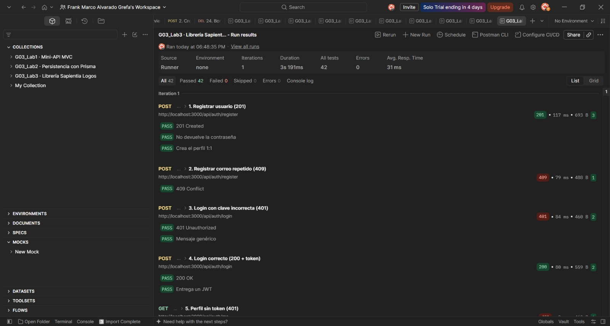
 
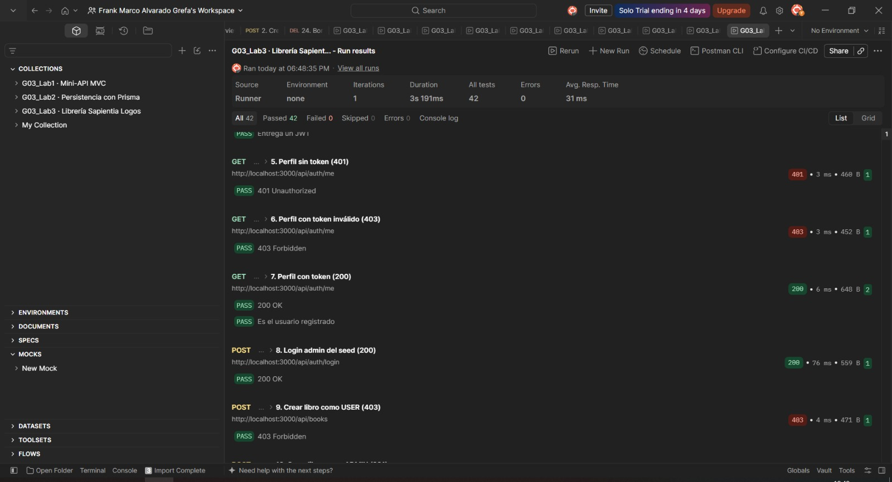
 
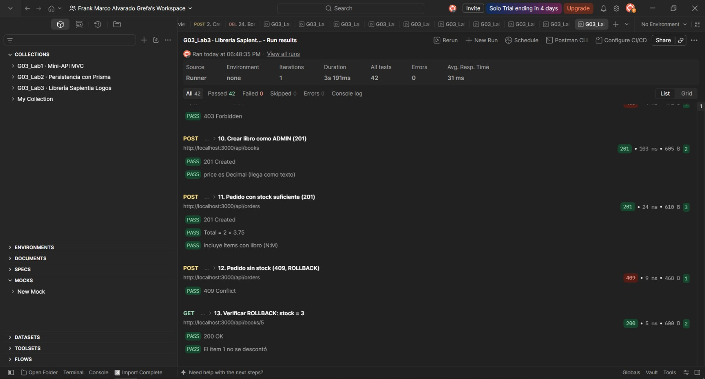
 
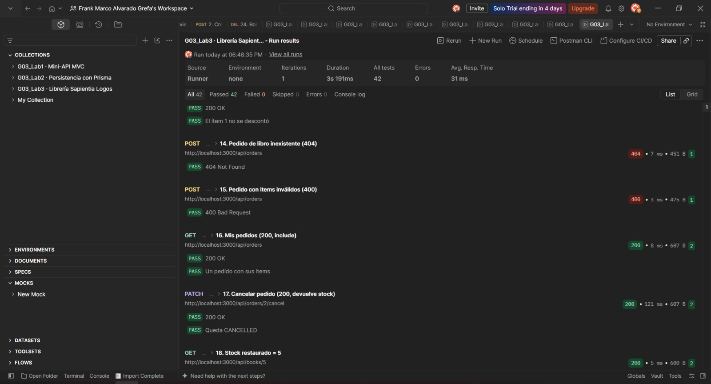
 
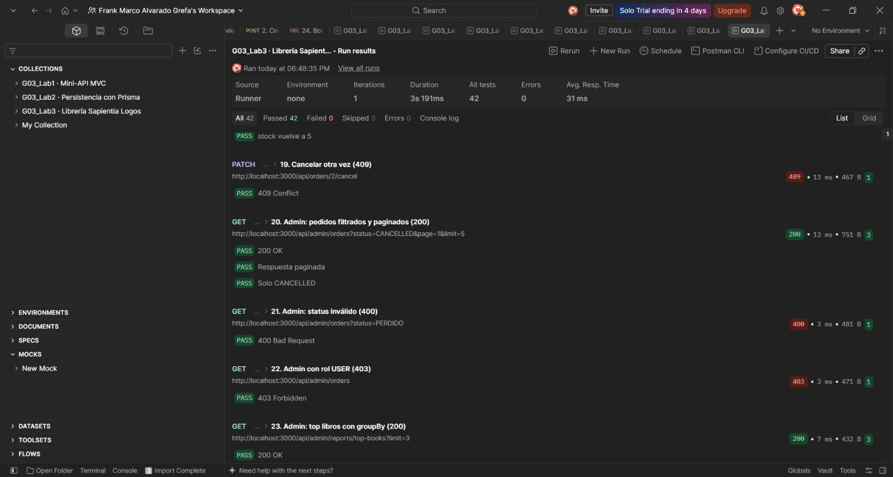
 
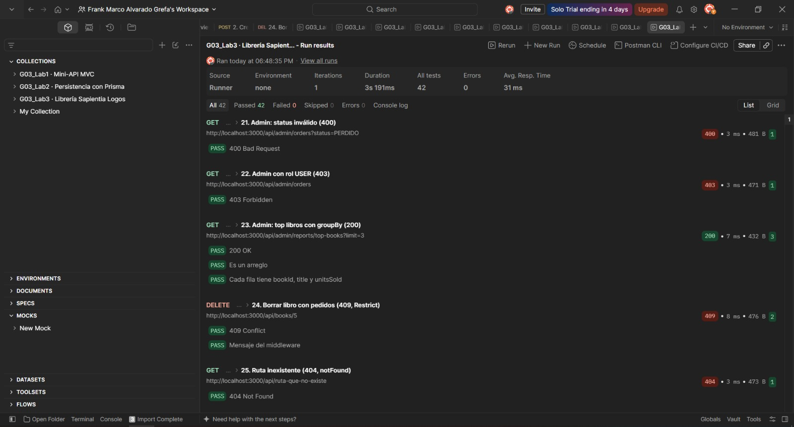
 
 
Base de datos creada por la migración `relaciones`, con las llaves foráneas (pgAdmin):
 
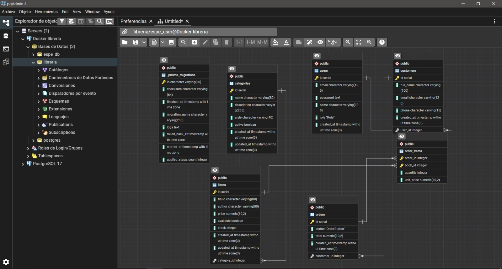
 
Servicio y base de datos en Render:
 
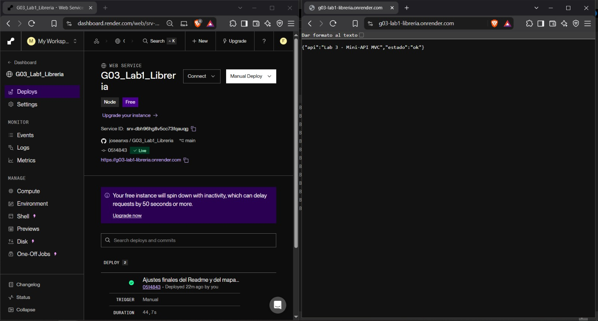
 
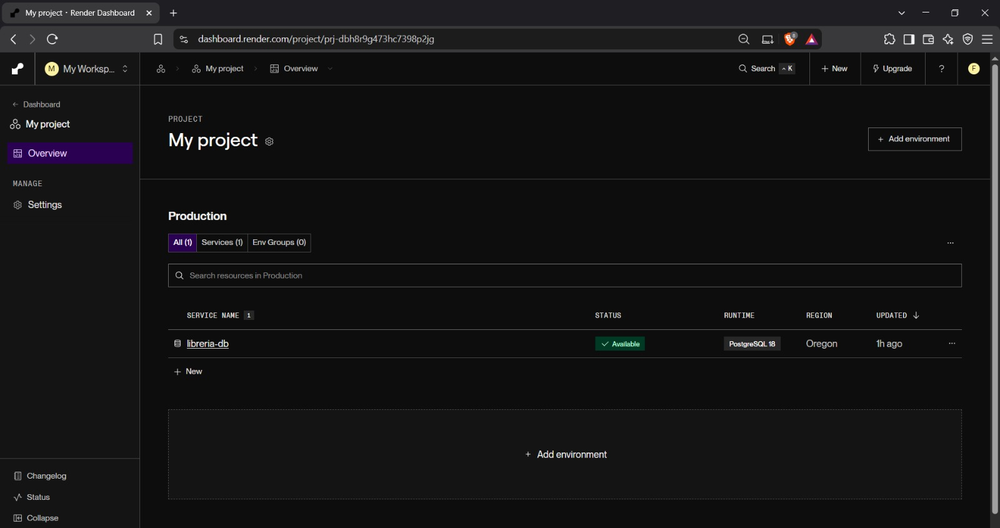
 

## Aporte de cada integrante (Lab 3)
 
| Integrante | Rol | Qué hizo (archivos / pasos) |
|---|---|---|
| **Jose Reinoso** | Integrante 1: Primera versión de autenticación, pedidos y administración | • **Autenticación:** rutas, controlador y servicio de auth y `middlewares/auth.js`.<br>• **Pedidos y administración:** controladores, rutas y servicios de `orders` y `admin`.<br>• **Datos:** primera versión del seed relacional y de `book.routes.js`. |
| **Yostin Sisalema** | Integrante 2: Schema, migración y seguridad | • **Datos:** `schema.prisma` con las relaciones, la migración `relaciones` y los ajustes del seed.<br>• **Modelo:** `MODELO_ER.md` final con cardinalidades y `onDelete`.<br>• **Seguridad y pedidos:** `requireRole`, ajustes de `auth.service.js` y `order.service.js` (actualización condicional y cancelación).<br>• **Limpieza:** `book.routes.js`. |
| **Frank Alvarado** | Integrante 3: Errores, Postman y despliegue | • **Manejo de errores:** `errorHandler.js` con 409 y 404 de Prisma y claves foráneas.<br>• **Postman:** colección adaptada de 25 peticiones y su ejecución en local y en Render.<br>• **Despliegue:** servicio y base PostgreSQL en Render, variables de entorno y seed contra la base externa.<br>• **Documentación:** evidencias y este `README.md`. |

### Nota Adiccional: Sobre el desarrollo del /client

Con respecto al desarrollo del /client, realizamos una reunión en Live Server para coordinar el diseño. Al trabajar con React (un framework para el desarrollo de interfaces de usuario), nuestro enfoque principal fue estructurar y diseñar los componentes de la interfaz. En este proceso, empleamos el diagrama del [Mapa del sistema](mapa_G03_Lab1.png) como guía para el desarrollo del cliente. La estructura de estos componentes y sus conexiones mutuas se pueden apreciar en la imagen [Diseño del sistema](diseno_visual.png). Por último, cabe añadir que implementamos la plantilla del repositorio shadcn-admin.

## Taller · Tarjeta A · Reseñas · Yostin Sisalema

Los usuarios califican un libro con 1 a 5 estrellas y un comentario opcional. Cada usuario puede reseñar un mismo libro una sola vez.

### Contrato de los endpoints

| Método | Ruta | Rol | Body | Respuestas |
|--------|------|-----|------|------------|
| POST | `/api/books/:id/reviews` | Usuario autenticado | `{ rating: 1-5, comment?: texto de hasta 300 caracteres }` | 201 reseña creada · 400 `rating` o `comment` inválidos · 401 sin token · 403 token inválido · 404 libro inexistente · 409 ya reseñó ese libro |
| GET | `/api/books/:id/reviews?page&limit` | Público | n/a (query: `page`, `limit`) | 200 `{ bookId, average, total, page, limit, pages, data }` · 400 id no numérico · 404 libro inexistente |
| DELETE | `/api/reviews/:id` | Autor o ADMIN | n/a | 204 sin cuerpo · 400 id no numérico · 401 sin token · 403 no es el autor · 404 reseña inexistente |

### Modelo y decisiones

**Modelo:** `Review` tiene una relación 1:N con `User` y otra 1:N con `Book`, con `@@unique([userId, bookId])` (una reseña por usuario y libro), `rating` como `@db.SmallInt`, `@@index([bookId])` para listar las reseñas de un libro y `@@map("reviews")`. Ambas relaciones usan `onDelete: Cascade`: una reseña no tiene sentido sin su autor ni sin el libro reseñado, así que si se elimina cualquiera de los dos, la reseña se elimina con él. El modelo se incluye en el `schema.prisma` común y en la migración única `taller` que sube el integrador.

**Decisiones de diseño:**

- `rating` debe ser un entero de 1 a 5 (`"5"` o `4.5` responden 400). `comment` es opcional; si llega vacío o solo con espacios se guarda como `null`.
- El 409 de reseña repetida lo garantiza la base con el único compuesto, así que dos peticiones simultáneas del mismo usuario no pueden crear dos reseñas.
- El listado devuelve las reseñas más recientes primero, con el nombre del autor (nunca su correo ni su contraseña). El promedio sale de `aggregate` con `_avg`, redondeado a 2 decimales, y es `null` cuando el libro no tiene reseñas.
- `page` vale 1 y `limit` vale 10 por defecto, con un máximo de 50. Los valores inválidos usan los valores por defecto.
- Un ADMIN puede eliminar cualquier reseña, y el autor solo la suya.

### Archivos de la tarjeta

- `src/routes/review.routes.js`, `src/controllers/review.controller.js` y `src/services/review.service.js`: ruta → controlador → servicio. Las consultas de Prisma están solo en el servicio, y los errores salen por `HttpError` hacia `errorHandler`.
- `src/routes/book.routes.js`: las rutas `GET` y `POST /:id/reviews`. `src/routes/index.js`: monta `/api/reviews`.

### Pruebas en Postman

La carpeta **«Taller · A · Reseñas · Yostin Sisalema»** tiene 21 peticiones con `pm.test` sobre el código y sobre el cuerpo de la respuesta: 5 de preparación (`A0`, inician sesión y crean los datos que necesita) y 16 del contrato (`A1` a `A16`). La carpeta es autónoma: no depende de las carpetas del Lab 3, solo de que la base tenga el seed (el administrador y Ana) y de que la tabla `reviews` esté migrada.

| # | Petición | Resultado esperado |
|---|---|---|
| A1 | Crear reseña | 201, con `id`, `rating` y `comment`, sin datos sensibles |
| A2 | Reseña repetida del mismo usuario | 409 |
| A3 | `rating` fuera de 1 a 5 | 400 |
| A4 | `comment` de más de 300 caracteres | 400 |
| A5 | Crear reseña sin token | 401 |
| A6 | Libro inexistente | 404 |
| A7 | Reseña de otro usuario | 201 |
| A8 | Listar reseñas (público) | 200, promedio 4, total 2, la más reciente primero y con el nombre del autor |
| A9 | Paginación: página 2 con `limit` 1 | 200, `pages` 2 y una sola reseña |
| A10 | Listar reseñas de un libro inexistente | 404 |
| A11 | Eliminar la reseña de otro usuario | 403 |
| A12 | El autor elimina su reseña | 204 sin cuerpo |
| A13 | Eliminar una reseña que ya no existe | 404 |
| A14 | Eliminar sin token | 401 |
| A15 | Un ADMIN elimina la reseña de otro usuario | 204 |
| A16 | Libro sin reseñas | 200, `average` null, `total` 0 y `data` vacía |

Para ejecutarla: aplica la migración del taller (`npx prisma migrate dev`) y `npx prisma generate`, carga los datos con `npm run db:seed`, enciende la API (`npm run dev`) y en Postman usa **Run folder** sobre la carpeta.

**Evidencias:** la ejecución de la carpeta pasó las 40 aserciones, con 0 fallos. Los códigos 403, 404 y 401 en rojo son los casos de error del contrato, y sus pruebas aparecen en verde porque la API responde justo el código esperado.

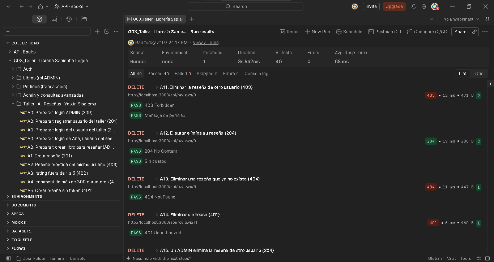

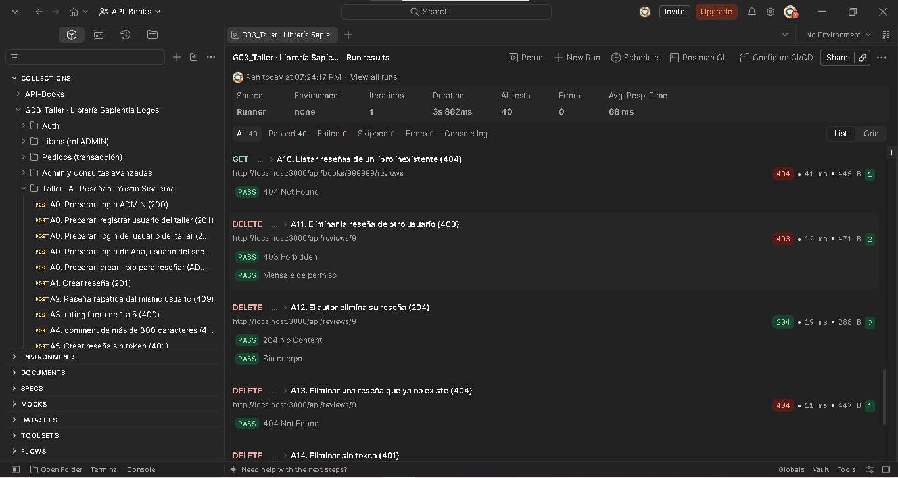


## Uso de IA

- **Herramienta:** Claude (Anthropic), en su plataforma web.
- **Para qué la usamos:**
  - Para adaptar los pasos de despliegue de Railway a Render, revisar que la URL pública respondiera (`GET /api/books` devolvió los libros en JSON). 
- **Qué verificamos o modificamos nosotros:**
  - Aplicamos la migración `relaciones` y cargamos el seed en PostgreSQL, y comprobamos las tablas y las llaves foráneas en pgAdmin (`evidencias/bd.png.j- peg`).
  - Se verificó o modificó manualmente (pruebas en Postman, error 409 por FK, ROLLBACK sin stock)._
