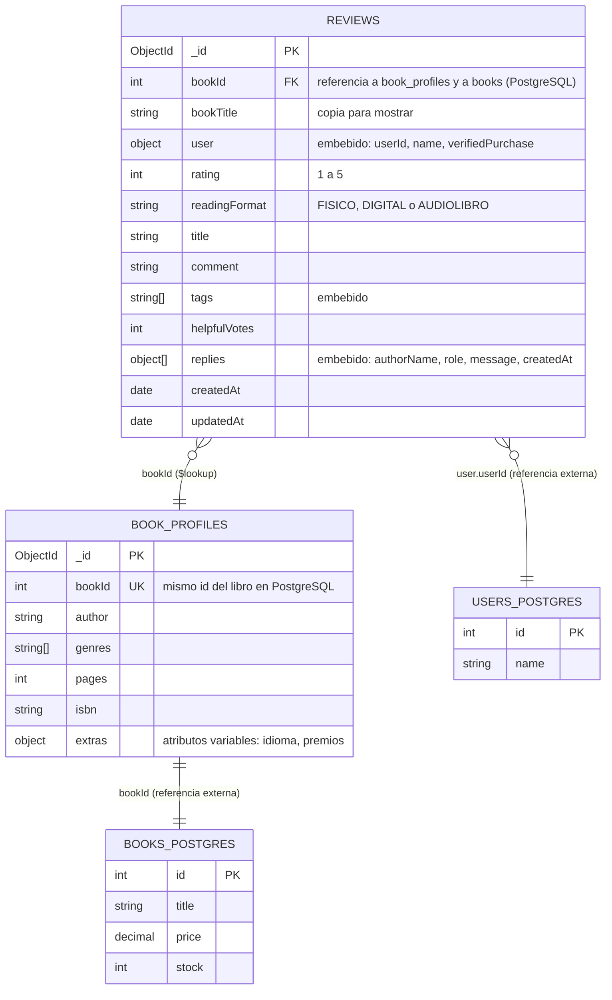
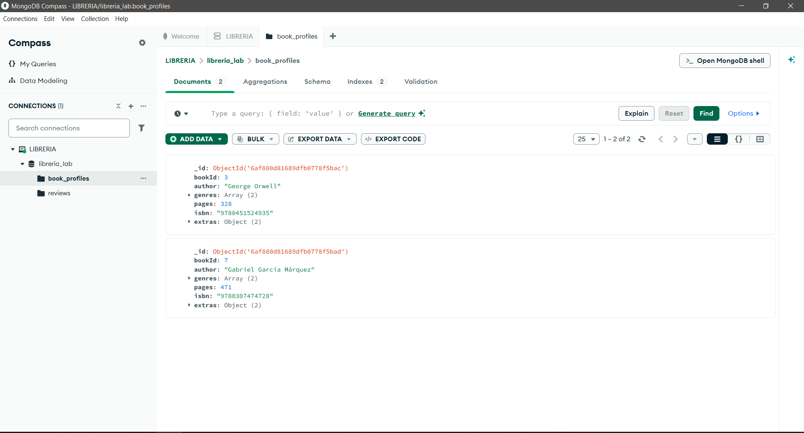

# Hito 2 · Workload y modelo documental

**Grupo:** G03  **Emprendimiento:** Librería Sapientia Logos  **Colección elegida (hito 1):** `reviews` (reseñas y comentarios de libros)

## 1. Workload

| Actor | Operación | Lectura o escritura | Frecuencia (por día/hora) | Datos que usa |
|---|---|---|---|---|
| Visitante / cliente | Ver las reseñas de un libro (recientes o más útiles primero) | Lectura | ~1 500 por hora en hora pico (cada visita a la ficha de un libro) | `bookId`, `rating`, `title`, `comment`, `tags`, `helpfulVotes`, `user.name`, `replies`, `createdAt` |
| Visitante / cliente | Ver el promedio de calificación de un libro | Lectura | ~800 por hora (catálogo y ficha) | `bookId`, `rating` |
| Cliente | Publicar una reseña de un libro que compró | Escritura | ~30 por día | Todos los campos de la reseña, `user.userId`, `user.verifiedPurchase` |
| Cliente | Marcar una reseña como útil | Escritura | ~100 por día | `_id`, `helpfulVotes` |
| Administrador | Responder una reseña | Escritura | ~5 por día | `_id`, `replies` |
| Administrador | Moderar o eliminar una reseña | Escritura | ~2 por día | `_id` |
| Cliente | Ver sus propias reseñas | Lectura | ~20 por día | `user.userId`, `bookTitle`, `rating`, `comment`, `createdAt` |

*Las frecuencias son estimaciones del grupo para una librería en línea mediana.* El patrón que se desprende es claro: **la colección se lee muchísimo más de lo que se escribe, y casi siempre por libro** (`bookId`). Por eso la reseña guarda en un solo documento todo lo que se muestra en pantalla y `bookId` lleva índice.

## 2. Relaciones: embeber o referenciar

| Relación | Cardinalidad | ¿Se lee junto? | ¿Cambia seguido? | ¿Crece sin límite? | Decisión |
|---|---|---|---|---|---|
| Reseña → `replies` (respuestas de la librería) | 1:N | Sí, se muestran bajo la reseña | No (unas pocas por semana) | No, pocas por reseña | **Embebida** (`replies[]`) |
| Reseña → `tags` (etiquetas de opinión) | 1:N | Sí | No | No (máximo 8) | **Embebida** (`tags[]`) |
| Reseña → autor (`user`) | N:1 | Sí, se muestra el nombre | No (el nombre casi no cambia) | No (es una copia mínima) | **Embebida**: copia de `userId`, `name`, `verifiedPurchase`; el usuario completo sigue en PostgreSQL |
| Reseña → libro del catálogo | N:1 | Solo el título | Sí (precio y stock cambian en PostgreSQL) | Sí, un libro acumula reseñas sin límite | **Referenciada** con `bookId`; `bookTitle` se guarda como copia solo para mostrar |
| Reseña → ficha ampliada del libro (`book_profiles`) | N:1 | Solo en la ficha del libro | A veces (se corrigen datos del libro) | Sí, la comparten todas las reseñas del libro | **Referenciada** (colección aparte, unida con `$lookup` por `bookId`) |

**Por qué `book_profiles` no se embebe:** repetir autor, géneros y páginas dentro de cada reseña los duplicaría miles de veces, y corregir un dato obligaría a editar todas las reseñas del libro.

## 3. ER de MongoDB

Lo embebido se dibuja DENTRO de la entidad (`campo[]`); lo referenciado, como caja aparte unida con una línea (`*_id`).

## 4. Playground (`grupoG03.mongodb.js`)

- [x] `createCollection` con `$jsonSchema`: 1 `enum` (`readingFormat`), 1 rango (`rating`, `minimum` 1 y `maximum` 5) y 1 arreglo (`tags`, máximo 8 y sin repetidos)
- [x] 2 inserts válidos (1984 y Cien años de soledad) y 2 rechazados (`rating` fuera de rango y `readingFormat` fuera del enum), con el campo que falló impreso
- [x] `$lookup` entre dos colecciones (`reviews` → `book_profiles`) con `$unwind`

## 5. Evidencia

