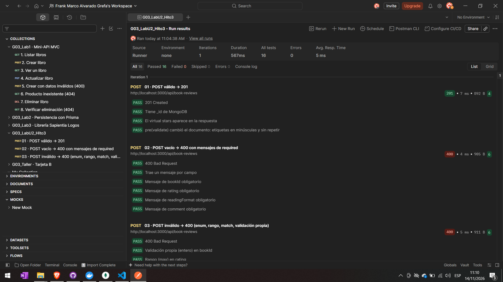
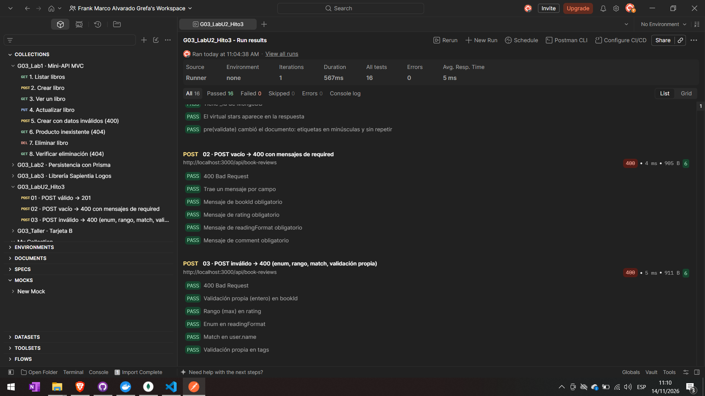
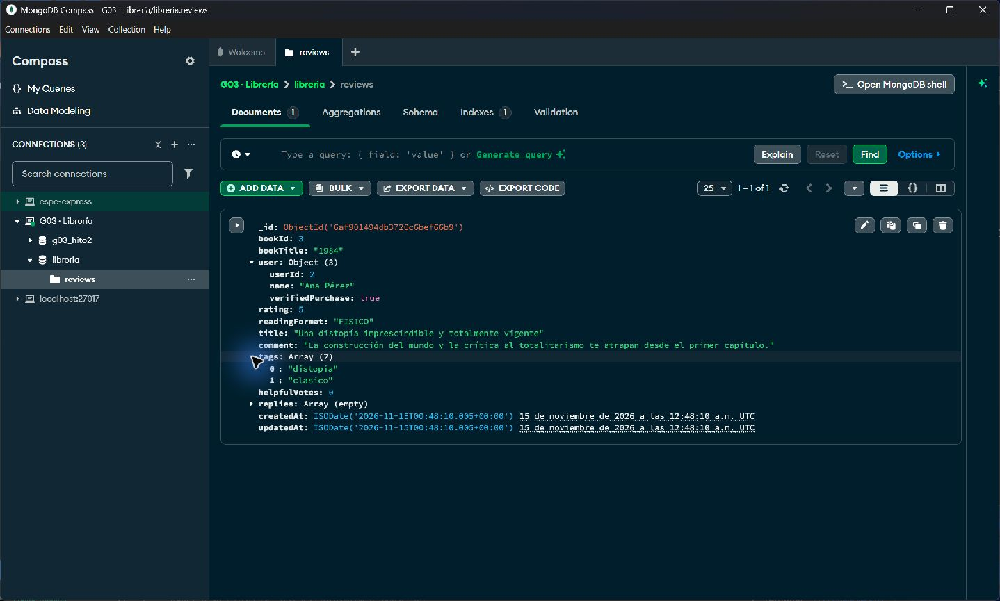

# Hito 3 · Modelo Mongoose y POST en capas

**Grupo:** G03 · **Emprendimiento:** Librería Sapientia Logos

Se incorporaron los archivos del ZIP `G03_Lab1_Libreria-u2-hito-3.zip` para el
recurso **`book-reviews`**, colección MongoDB **`libreria.reviews`**. Se conservaron
los hitos 1 y 2 y las rutas relacionales existentes.

## Archivos trasladados

| Archivo | Responsabilidad |
|---|---|
| `src/db/mongo.js` | `await mongoose.connect(process.env.MONGODB_URI)` |
| `src/server.js` | Conecta PostgreSQL y MongoDB antes de llamar a `listen`; termina si falla una conexión |
| `src/models/bookReview.js` | Esquema documental, validaciones, virtual y middleware Mongoose |
| `src/routes/bookReview.routes.js` | Define `POST /` del recurso |
| `src/controllers/bookReview.controller.js` | Responde 201 o transforma `ValidationError` en 400 con mensajes por campo |
| `src/services/bookReview.service.js` | Selecciona los campos permitidos y usa `BookReview.create()` |
| `src/routes/index.js` | Monta el recurso en `/book-reviews` bajo el prefijo `/api` de Express |
| `postman/G03_LabU2_Hito3.postman_collection.json` | Un POST válido y dos inválidos, con 16 aserciones |

Las capturas tienen nombres que identifican la herramienta y el hito:
`evidencia-compass-hito2.png`, `evidencia-compass-hito3.png`,
`evidencia-postman-hito3-1.png` y `evidencia-postman-hito3-2.png`.
La imagen de `book_profiles` del ZIP corresponde al hito 2. Para el hito 3 se
recuperó la captura local de `libreria.reviews` que ya estaba guardada en Git.

Las dependencias exactas `mongoose@9.11.4` y `validator@13.15.35` ya estaban
declaradas en el proyecto. Se instalaron sin sustituir `package.json` ni el lockfile.
En `.env.example` se completaron el puerto `3000` y el nombre de base `libreria`
en lugar de los marcadores `30XX` y `<base>`. El `.env` local queda fuera de Git.

## Modelo y respuesta

El esquema implementa:

- **required con mensaje:** `bookId`, `bookTitle`, `user.userId`, `user.name`,
  `rating`, `readingFormat` y `comment`.
- **enum con mensaje:** formatos `FISICO`, `DIGITAL`, `AUDIOLIBRO` y roles de respuestas.
- **Rango y longitudes con mensaje:** estrellas de 1 a 5; límites de títulos,
  nombres y comentarios.
- **match con mensaje:** `user.name` admite letras, espacios, punto, apóstrofe y guion.
- **Validación propia con mensaje:** identificadores y estrellas enteros; hasta
  ocho etiquetas con longitud y formato válidos, usando `validator`.
- **Virtual `stars`:** devuelve texto como `5 de 5`, sin emojis; aparece en JSON y no
  se persiste en MongoDB.
- **`pre("validate")`:** recorta las etiquetas, las pasa a minúsculas y elimina
  repetidas antes de validar el documento.

Flujo: **ruta → controlador → servicio → modelo Mongoose → MongoDB**.

`POST /api/book-reviews` responde **201** con el documento y `stars`, o **400**
con el siguiente formato cuando Mongoose produce un `ValidationError`:

```json
{
  "message": "Datos inválidos",
  "errors": [
    { "field": "rating", "message": "La calificación es obligatoria" }
  ]
}
```

`bookId` y `user.userId` son referencias lógicas a identificadores de PostgreSQL.
Este POST de laboratorio no consulta esas tablas para comprobar su existencia;
mantiene el comportamiento del ZIP y no sustituye las rutas relacionales de reseñas.

## Ejecutar

Desde la raíz del repositorio, con Node.js 20.19 o superior:

```powershell
Copy-Item .env.example .env  # Solo si todavía no tienes .env; configura JWT_SECRET.
npm ci
docker compose up -d postgres mongo
npm run dev
```

La URI de desarrollo usa `libreria` y `authSource=admin`. La base `libreria_lab`
del Playground del hito 2 permanece separada: no es necesario ejecutarlo para
usar el POST de este hito.

En Postman, importar `postman/G03_LabU2_Hito3.postman_collection.json`, dejar
`baseUrl=http://localhost:3000` y `recurso=book-reviews`, y ejecutar la colección.
También se puede ejecutar localmente con Postman CLI:

```powershell
postman collection run postman/G03_LabU2_Hito3.postman_collection.json --no-report-events
```

Cada ejecución inserta una reseña nueva con el caso válido. Los casos inválidos
no generan documentos. No se requiere iniciar sesión en Postman para esta
ejecución local sin reporte en la nube; el CLI puede mostrar avisos de sesión.

## Verificación local · 14 de noviembre de 2026

La colección se ejecutó contra la API y ambas bases reales:

| Caso | Resultado | Aserciones aprobadas |
|---|---|---:|
| POST válido | 201; `_id`, virtual `5 de 5` y tags `distopia`, `clasico` | 4 |
| POST vacío | 400; mensajes de campos obligatorios | 6 |
| POST con enum, rango, nombre y etiquetas inválidos | 400; mensajes por cada campo | 6 |
| **Total** | **3 peticiones, 0 fallos** | **16 de 16** |

Además, un proceso separado con MongoDB inaccesible terminó con código 1 y no
ejecutó `listen`. La API de prueba normal no se modificó durante esa comprobación.

## Evidencias

Capturas de Postman trasladadas del ZIP:





Captura local de Compass, con la conexión **G03 · Librería**, la colección
**`libreria.reviews`** y el documento creado por la colección Postman. Las etiquetas
normalizadas se ven almacenadas; el virtual `stars` solo aparece en la respuesta
HTTP, ya que no es un campo persistido:



## Cierre

La entrega se guarda en un commit local con la etiqueta **`u2-hito-3`**.
Se puede comprobar con `git show --stat u2-hito-3`. No se publica en el remoto.
